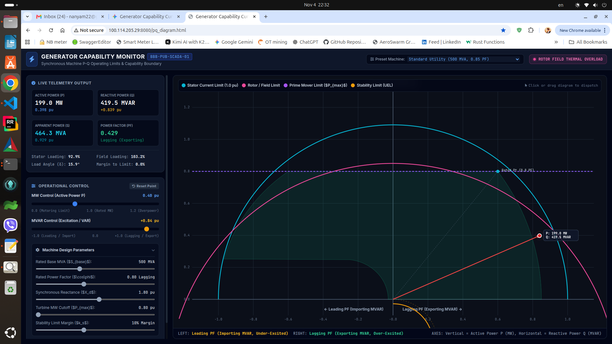
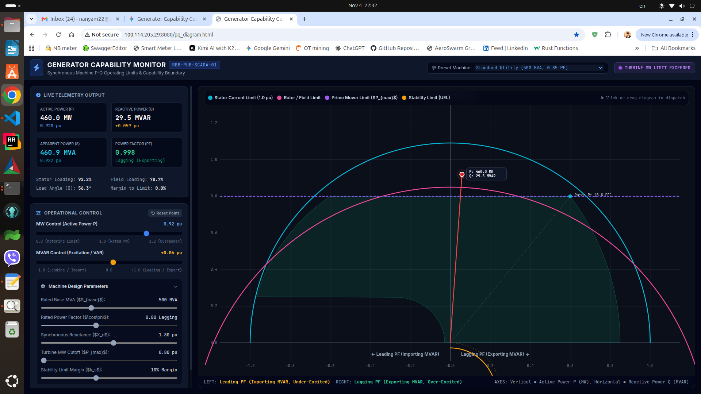
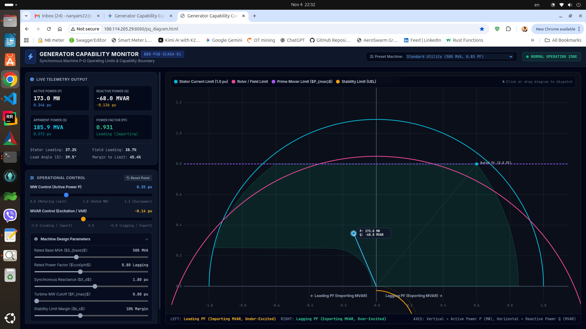

# BBB Synchronous Generator P-Q Telemetry & Stability Limit Engine

A lightweight, real-time power plant control room telemetry engine and web dashboard running on **BeagleBone Black (BBB)**. This project models synchronous machine capability curves, rotor field current excitation contours, and the Under-Excitation Steady-State Stability Limit (SSSL) curve, bridging a native C backend to an interactive HTML5 browser UI via file-based JSON IPC.







---

## Project Directory Structure

```text
power-plant-control-room/
├── include/
│   └── generator_pq.h       # Synchronous machine struct definitions & prototypes
├── src/
│   └── main.c               # Native C telemetry loop & JSON exporter
├── www/
│   ├── pq_diagram.html      # Interactive P-Q capability UI & time-domain oscillograms
│   └── telemetry.json       # Shared IPC state file (auto-updated by C engine)
├── jpeg/
│   └── README.md            # Visual assets & screen capture placeholder
├── Makefile                 # Zero-dependency build script
└── README.md                # Project documentation
FeaturesNative C Backend Engine (src/main.c):Computes Active ($P$) and Reactive ($Q$) power per-unit conversions.Evaluates Stator Current loading ($I_{stator}$) and Rotor Field Current ($I_f$).Calculates saliency-based load angles ($\delta$) using $X_d$ and $X_q$ reactances.Enforces the Under-Excitation Steady-State Stability Limit (SSSL / pole-slip boundary).Exports machine telemetry atomically to www/telemetry.json every 200ms.Interactive HTML/JS Web Dashboard (www/pq_diagram.html):P-Q Capability Plane: Plots vertical active power ($P$, MW) against horizontal reactive power ($Q$, MVAR) where $Q > 0$ is lagging (exporting) and $Q < 0$ is leading (importing).Capability Boundaries: Includes 1.0 pu Stator Current arc, zero-excitation reluctance circle, multiple rotor field current contours ($I_f$), and the $\delta = 90^\circ$ SSSL stability curve.Time-Domain Oscillogram: Displays a fixed voltage waveform $V(t)$ alongside a dynamically scaled and phase-shifted current waveform $I(t)$ driven by real-time operating parameters.Building & Running1. Compile the C Telemetry EngineFrom the project root directory, build using the Makefile:Bashmake
2. Start the HTTP Web ServerNavigate to the www/ directory and start Python's built-in HTTP server on port 8080:Bashcd www
python3 -m http.server 8080
(If port 8080 is already occupied, free it with fuser -k 8080/tcp)3. Run the C Telemetry DaemonIn a separate terminal window from the project root, start the telemetry engine:Bash./generator_pq_engine
4. Access the DashboardOpen your web browser and navigate to:Plaintexthttp:  http://100.114.205.29:8080/pq_diagram.html
